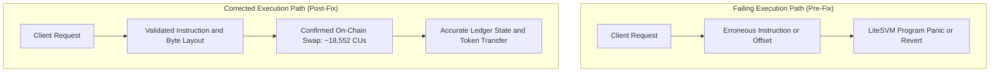

## 1. Incident Overview & Bug Summary

### Defect Description
<!-- Describe the exact failure observed. What was supposed to happen vs what actually broke? -->
- **Observed Behavior:** 
- **Expected Behavior:** 

### Error Diagnostics & Logs
<!-- Paste the exact terminal error traceback, Python exception, or Solana on-chain program log -->
```text
Example: Program 675kPX9MHTjS2zt1qfr1NYHuzeLXfQM9H24wFSUt1Mp8 failed: custom program error: 0x1c
```

### Failure Classification & Scope
- **Severity Level:** [ ] Critical Blocker (Halts execution/CI) / [ ] High (Incorrect math/swap failure) / [ ] Medium (Edge case/Bad CLI input) / [ ] Low (Formatting/Typo)
- **Subsystem Affected:**
  - [ ] LiteSVM Ledger & Account Hydration (`fixtures/*.json`)
  - [ ] On-Chain Bytecode Execution (`fixtures/*.so`)
  - [ ] Instruction Serialization & Struct Packing (`struct.pack`)
  - [ ] Account Meta Permutations (`is_signer`, `is_writable`)
  - [ ] SPL Token ATA Derivation & Balance Reading (Byte Offsets 64..72)
  - [ ] Slippage Bounds & Constant Product Invariant Math

---

## 2. Technical Root Cause Analysis (RCA)

### Why Did This Defect Occur?
<!-- Explain the technical root cause in depth. Was it a byte offset mismatch, account ordering issue, missing fixture, or data endianness problem? -->

### Technical Deep Dive
- **Failing Source File & Line Range:** `file:///path/to/file#L00-L00`
- **Root Cause Mechanism:** 
- **Why It Passed Previous Tests:** 

---

## 3. Architecture & Resolution Data Flow



### Detailed Component Changes
| Component / File | Erroneous Behavior Before Fix | Corrected Behavior After Fix |
| :--- | :--- | :--- |
|  |  |  |

---

## 4. Reproduction & Verification Playbook

### Step 1: Reproduction Command (Before Fix)
<!-- Exact CLI command that reliably triggered the failure -->
```bash

```
*Expected Failure Output:* `[Error: ...]`

### Step 2: Verification Command (After Fix)
<!-- Exact CLI command confirming the bug is fully resolved -->
```bash
python early-code/raydium.py --direction sol-to-usdc --amount 2.0
```

### Step 3: Verified Post-Fix Metrics
- **Execution Status:** Confirmed by Raydium smart contract on LiteSVM
- **Compute Units Consumed:** ~18,552 CUs
- **Exit Code:** 0 (Clean exit with zero unhandled exceptions)

---

## 5. Ledger State & Balance Delta Verification

| Ledger Account | Pre-Swap Balance | Post-Swap Balance | Verified Correctness |
| :--- | :--- | :--- | :--- |
| **Trader Input Account** |  |  | [ ] Exact amount debited |
| **Trader Output Account** |  |  | [ ] Expected tokens credited |
| **Pool Coin Vault (WSOL)** |  |  | [ ] Invariant x * y = k preserved |
| **Pool PC Vault (USDC)** |  |  | [ ] Fee correctly collected |

---

## 6. Comprehensive Bugfix Pre-Merge Checklist

### Defect Isolation & Verification
- [ ] Root cause identified, isolated, and documented with exact line references.
- [ ] Bug reliably reproduced on the failing commit before applying the patch.
- [ ] Verified that edge cases (e.g. zero amounts, extreme slippage, empty accounts) fail gracefully.
- [ ] Confirmed that on-chain constant product math (k = x * y) remains mathematically sound.

### SVM Fidelity & Safety
- [ ] Confirmed no simulated/mock vaults or hardcoded balances were reintroduced.
- [ ] Verified SPL Token account byte offsets strictly match official layout (mint: 0..32, owner: 32..64, amount: 64..72).
- [ ] All 18 Raydium Swap account metas verified for exact is_signer and is_writable flags.
- [ ] Execution completes within standard Solana compute unit limits (< 200,000 CUs).

### Repository, CI & Standards
- [ ] PR Title strictly follows Conventional Commits format (`fix: ...`).
- [ ] Clean git diff: only files strictly necessary for the bugfix are modified.
- [ ] `CHANGELOG.md` updated with issue description and resolution details.
- [ ] GitHub Actions CI workflows pass with all green checks.
