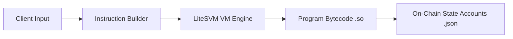

## 1. Feature Overview & Purpose
<!-- What new simulation capability, DEX integration, or arbitrage feature does this introduce? -->

## 2. Sprint Roadmap Alignment
<!-- Which milestone does this satisfy (e.g. Step 4: LiteSVM Execution, Step 5: Multi-Market Arbitrage)? -->

---

## 3. Technical Architecture & Data Flow



### Key Files Changed / Created
| File Location | Component | Role in Feature |
| :--- | :--- | :--- |
|  |  |  |

---

## 4. On-Chain Programs & Market Accounts Utilized

| Account / Binary | Type | On-Chain Address / Path | Function in Execution |
| :--- | :--- | :--- | :--- |
| `fixtures/raydium_amm.so` | Program Binary | `675kPX9MHTjS2zt1qfr1NYHuzeLXfQM9H24wFSUt1Mp8` | Executes constant-product swaps and fee deductions. |
| `fixtures/coin_vault.json` | Account Snapshot | `DQyrAcCrDXQ7NeoqGgDCZwBvWDcYmFCjSb9JtteuvPpz` | Provides 157,470.60 SOL real liquidity reserves. |
| `fixtures/pc_vault.json` | Account Snapshot | `HLmqeL62xR1QoZ1HKKbXRrdN1p3phKpxRMb2VVopvBBz` | Provides 19,158,073.74 USDC real liquidity reserves. |

---

## 5. Mathematical Invariant & Economic Model
- **AMM Formula:** Constant Product ($x \cdot y = k$)
- **Fee Rate:** 25 basis points (0.25% standard Raydium pool fee)
- **Slippage Protection Mechanism:** User-defined `min_amount_out` boundary

---

## 6. Execution Verification & Ledger State Transitions

### Verification Command
```bash
python early-code/raydium.py --direction sol-to-usdc --amount 2.0
```

### Ledger State Before vs After Trade
| Metric | Pre-Execution State | Post-Execution State | Delta |
| :--- | :--- | :--- | :--- |
| **SOL Vault Reserve** | 157,470.6015 SOL | 157,472.6015 SOL | +2.0000 SOL |
| **USDC Vault Reserve** | 19,158,073.74 USDC | 19,157,831.03 USDC | -242.7112 USDC |
| **Trader WSOL ATA** | 2.0000 SOL | 0.0000 SOL | -2.0000 SOL |
| **Trader USDC ATA** | 0.0000 USDC | +242.7112 USDC | +242.7112 USDC |

### Performance & Resource Profiling
- **Transaction Status:** Confirmed by Raydium smart contract
- **Compute Units Consumed:** ~18,552 CUs (Well within standard 200,000 CU limit)
- **Execution Cost:** 0 Lamports (Simulated locally inside LiteSVM)

---

## 7. Detailed Engineering Pre-Merge Checklist

### Architecture & SVM Accuracy
- [ ] Executes official on-chain program bytecode (`.so`) rather than simulated/mock vaults.
- [ ] Account byte offsets (e.g. SPL Token balance at 64..72) match official Solana layouts.
- [ ] Program Derived Addresses (PDAs) and Associated Token Accounts (ATAs) derive with exact official seeds.
- [ ] Program binaries and snapshot accounts correctly tracked without gitignore conflicts.

### Execution & Safety Verification
- [ ] Swap instruction validates both input amount and minimum output boundary (`min_amount_out`).
- [ ] Tested both forward and reverse trading directions (e.g. SOL $\rightarrow$ USDC and USDC $\rightarrow$ SOL).
- [ ] Compute units consumed remain well within standard Solana instruction budget (< 200,000 CUs).
- [ ] Local simulation executes cleanly with exit code 0 and no unhandled program panics.

### Quality, CI & Documentation
- [ ] PR Title strictly adheres to Conventional Commits standard (e.g. `feat: ...`).
- [ ] Self-reviewed code for formatting, comments, and eliminated dead/test code.
- [ ] `CHANGELOG.md` updated with completed sprint work and roadmap milestone progress.
- [ ] GitHub Actions CI workflows pass with green checks.
