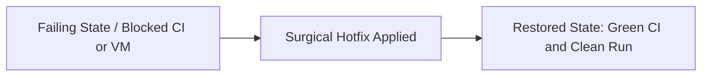

## 1. 🚨 Emergency Hotfix Overview

### Incident Summary
<!-- Critical issue requiring immediate merge to unblock development, CI/CD pipelines, or broken environments. -->
- **Trigger Event:** 
- **Impacted Subsystem:** [ ] CI/CD Workflow / [ ] Program Bytecode Loading / [ ] Environment Setup / [ ] LiteSVM Crash

### Urgency & Blast Radius
- **Severity Level:** 🔴 P0 - Critical Blocker (Completely halts progress or breaks main branch)
- **Time to Detect:** 
- **Time to Mitigate:** 

---

## 2. Immediate Cause & Surgical Patch Analysis

### What Broke?
<!-- Describe the specific failure (e.g. GitHub Actions runner timeout, missing .so gitignore exception, broken dependency). -->

### The Surgical Patch
<!-- Why is this patch minimal and low-risk? -->

---

## 3. Hotfix Architecture & Recovery Flow



### Files Touched by Hotfix
| File Location | Modification | Risk Assessment |
| :--- | :--- | :--- |
|  |  | Minimal / Isolated |

---

## 4. Rapid Verification Command

### Verification Command
<!-- Single command to prove the environment or build is restored -->
```bash
python early-code/raydium.py --direction sol-to-usdc --amount 2.0
```

### Confirmation Metrics
- **Exit Code:** 0
- **CI Workflow Status:** 🟢 All checks passing
- **No Side Effects:** Confirmed no unintended file changes

---

## 5. Rollback Strategy
<!-- If this hotfix produces unexpected issues, what is the exact rollback command? -->
- **Revert Command:** `git revert <commit-hash>`
- **Fallback Plan:** 

---

## 6. Emergency Hotfix Pre-Merge Checklist

### Scope & Safety
- [ ] Patch is strictly minimal (zero unrelated refactors or formatting changes).
- [ ] Root cause verified locally and fix proven to unblock execution.
- [ ] Confirmed that no secret keys, credentials, or unneeded binary caches are leaked.
- [ ] Rollback strategy verified in Section 5.

### CI/CD & Build Health
- [ ] Local build and execution exit with code 0.
- [ ] GitHub Actions CI workflow runs green on this branch.
- [ ] PR title strictly follows Conventional Commits format (`fix: ...` or `chore: ...`).

### Follow-Up Actions
- [ ] Documented in `CHANGELOG.md` under Hotfix / Urgent Patches.
- [ ] Identified whether a permanent architectural follow-up issue is needed.
