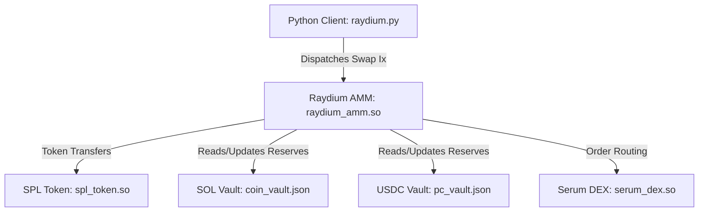

## 1. Summary

### What This Program Does
This program provides a direct, on-chain execution client for the **Raydium AMM V4** decentralized exchange inside **LiteSVM** (an in-process Solana Virtual Machine). It allows developers to execute two-way token swaps (SOL $\leftrightarrow$ USDC) against real Mainnet market liquidity.

### How It Achieves This
1. **Direct Smart Contract Execution:** Instead of simulating constant-product formulas in Python, LiteSVM loads and runs the official compiled Solana program bytecode (`raydium_amm.so`, `spl_token.so`, and `serum_dex.so`). The smart contract itself handles all token swap math, 0.25% fee deductions, and slippage checks.
2. **Mainnet State Hydration:** Hydrates the local LiteSVM ledger using serialized account snapshots (`fixtures/*.json`) dumped directly from Solana Mainnet-Beta. This includes the SOL/USDC pool state and real liquidity vaults holding **157,470.60 SOL** and **19,158,073.74 USDC**.
3. **Native Instruction Construction:** Derives official Associated Token Accounts (ATAs), builds the native Raydium V4 Swap instruction (Instruction Index 9) with the full 18-account metadata array, signs the transaction with the developer's real keypair (`~/.config/solana/id.json`), and processes it on the SVM.
4. **On-Chain Balance Inspection:** Reads updated token balances directly from on-chain SPL Token account byte offsets (bytes 64..72) and verifies that the transaction executed within standard compute unit budgets (~18,552 CUs).

---

### Architecture Overview



---

### Fixtures & Binaries Reference Table

| File Location | Type | One-Line Description |
| :--- | :--- | :--- |
| `fixtures/raydium_amm.so` | Program Binary | Core Raydium AMM V4 contract that executes swap math, fee deduction, and slippage checks. |
| `fixtures/spl_token.so` | Program Binary | Standard Solana SPL Token program that performs the actual token transfers between accounts. |
| `fixtures/serum_dex.so` | Program Binary | Serum DEX / OpenBook orderbook contract verified by Raydium for hybrid order routing. |
| `fixtures/raydium_pool.json` | Account Snapshot | SOL/USDC pool state containing status flags, fee rates, and pointers to the vaults. |
| `fixtures/coin_vault.json` | Account Snapshot | Mainnet WSOL token vault account holding 157,470.60 SOL pool liquidity. |
| `fixtures/pc_vault.json` | Account Snapshot | Mainnet USDC token vault account holding 19,158,073.74 USDC pool liquidity. |
| `fixtures/open_orders.json` | Account Snapshot | Raydium's order tracking account for liquidity placed on the Serum orderbook. |
| `fixtures/target_orders.json` | Account Snapshot | Target rebalancing account used by Raydium to manage Serum order depths. |
| `fixtures/market.json` | Account Snapshot | Serum SOL/USDC market configuration account referenced during swap verification. |
| `fixtures/bids.json` | Account Snapshot | Serum orderbook buy orders slab account required for market state verification. |
| `fixtures/asks.json` | Account Snapshot | Serum orderbook sell orders slab account required for market state verification. |
| `fixtures/event_q.json` | Account Snapshot | Serum event queue account tracking trade settlements. |
| `fixtures/market_coin_vault.json` | Account Snapshot | Serum DEX internal SOL vault referenced in swap account inputs. |
| `fixtures/market_pc_vault.json` | Account Snapshot | Serum DEX internal USDC vault referenced in swap account inputs. |

---

## 2. Type of Change
- [x] New feature (non-breaking change which adds functionality)
- [ ] Bug fix
- [x] Refactoring (replaces simulated mock vaults with on-chain bytecode execution)
- [x] Documentation update
- [x] Simulation / Fixture update

---

## 3. How to Verify

Run the swap execution command in your terminal:
```bash
python early-code/raydium.py --direction sol-to-usdc --amount 2.0
```

**Expected Result:**
- Output: `+242.7112 USDC` received.
- Status: Confirmed by Raydium smart contract.
- Compute Units: ~18,552 CUs consumed.

---
