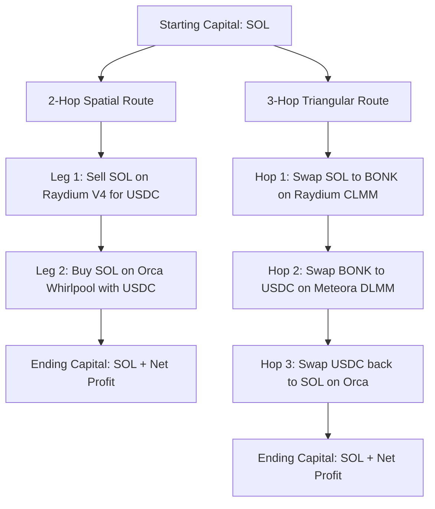
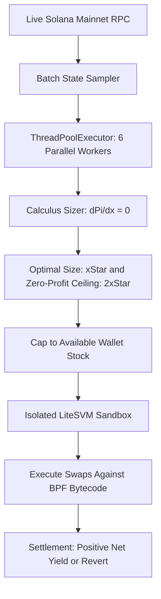

# Name

**Multi-Market & Multi-Token Arbitrage Simulation Engine**

---

## Description

This branch implements an autonomous on-chain multi-market arbitrage and latency testing harness across **Raydium AMM V4**, **Orca Whirlpools**, **Raydium CLMM**, and **Meteora DLMM** executed locally inside **LiteSVM** using live on-chain Mainnet state.

The suite contains three specialized execution engines:
1. **`multi_market_arbitrage.py`** — Multi-market, multi-token circular arbitrage engine with calculus-based optimal trade sizing ($x^*$), zero-profit ceiling enforcement ($2x^*$), and parallel multithreaded route discovery (`ThreadPoolExecutor`).
2. **`circular_arbitrage.py`** — Multithreaded two-way closed-loop spatial arbitrage engine (`SOL -> SOL` and `USDC -> USDC`) evaluating 4 circular routes simultaneously across parallel CPU worker threads every 100 ms.
3. **`live_arbitrage_monitor.py`** — High-frequency dual-market price monitor and network latency simulation (400 ms) with on-chain slippage reversion inside LiteSVM.

---

### In-Depth Technical & Logical Architecture

#### Engine 1: `multi_market_arbitrage.py` (Multi-Market Multi-Token Circular Engine with Optimal Sizing Calculus)
1. **Cross-Protocol Liquidity Graph:** Integrates diverse Automated Market Maker mechanisms across four protocols and four key SPL assets (`SOL`, `USDC`, `BONK`, `JitoSOL`):
   - **Raydium AMM V4:** Constant-product liquidity curve ($x \cdot y = k$) coupled to Serum orderbooks.
   - **Orca Whirlpools:** Concentrated liquidity market maker (CLMM) tracking active tick-arrays and $\sqrt{P}$ Q64.64 price representations.
   - **Raydium CLMM / CP-Swap:** High-efficiency localized fee tiers and tick liquidity.
   - **Meteora DLMM:** Dynamic liquidity bin corridors enabling zero-slippage rebalancing within active price bins.
2. **Strictly Closed-Loop Circular Invariant:** Eliminates directional market exposure by evaluating closed-cycle routing graphs:
   - **Spatial Circular Loops:** 2-hop cycles (`SOL -> Venue A -> USDC -> Venue B -> SOL` and `USDC -> Venue A -> SOL -> Venue B -> USDC`).
   - **Triangular Cross-Token Loops:** 3-hop cycles (`SOL -> BONK -> USDC -> SOL`).
3. **Calculus-Based Optimal Sizing Engine:**
   Analytical calculation of optimal capital injection $\Delta x^*$ to capture the peak of the profit curve where marginal profit equals zero ($\frac{d\Pi}{dx} = 0$):
   $$\Delta x^* = \frac{\sqrt{R_{A,1} \cdot R_{A,2} \cdot R_{B,1} \cdot R_{B,2} \cdot \gamma_A \cdot \gamma_B} - R_{A,1} \cdot R_{B,2}}{\gamma_B \cdot R_{A,2} + R_{B,2}}$$
   where $\gamma_k = 1 - \text{fee\_bps}_k / 10000$ represents pool retention after transaction fee deductions.
4. **Zero-Profit Slippage Ceiling ($2x^*$):**
   Due to constant-product quadratic price slippage, net profit returns to zero at twice the optimal input size:
   $$\Delta x_{\text{zero\_profit}} \approx 2 \cdot \Delta x^*$$
   Any trade size exceeding $2x^*$ exhausts the initial price spread and enters negative net return. The execution engine enforces:
   $$\text{Trade Size} = \min(x^*, \text{Available Wallet Stock})$$
   ensuring the engine never executes into negative yield or exceeds on-chain inventory.
5. **Multithreaded Parallel Route Discovery:** All candidate routes (spatial and triangular) are dispatched across a `concurrent.futures.ThreadPoolExecutor(max_workers=6)` pool, evaluating all permutation loops concurrently in memory.
6. **LiteSVM On-Chain Verification:** Opportunities identified in live memory are validated by instantiating LiteSVM and testing swap transactions directly against compiled BPF binaries in `fixtures/contracts/`.

#### Engine 2: `circular_arbitrage.py` (Two-Way Circular Spatial Arbitrage Engine)
1. **Closed-Loop Invariant:** Evaluates closed 2-way cycles (`SOL -> SOL` and `USDC -> USDC`) between Raydium V4 and Orca Whirlpools across 4 circular paths.
2. **Parallel Concurrency:** Dispatches all four circular routes into a `concurrent.futures.ThreadPoolExecutor(max_workers=4)` every 100 ms.
3. **Exact Fee & Concentrated Liquidity Math:** Evaluates Raydium 25 bps fees and Orca 4 bps fees (~29 bps round-trip friction threshold).
4. **Anchor IDL & Dual-DEX LiteSVM Execution:** Constructs instruction payloads using Anchor selector `0xf8c69e91e17587c8` executing against `raydium_amm.so` and `whirlpool.so`.

#### Engine 3: `live_arbitrage_monitor.py` (Real-Time Disparity & Latency Simulation)
1. **Live State Extraction:** Connects to Solana Mainnet JSON-RPC to sample live token reserves from Raydium and square-root prices from Orca.
2. **Divergence Detection:** Calculates spot prices across both AMMs simultaneously, flagging divergences exceeding 0.03%.
3. **Network Latency Simulation:** Enforces a deterministic propagation delay (400 ms) representing in-flight transit, mempool queuing, and slot leadership handoff.
4. **On-Chain Execution & Slippage Reversion:** Hydrates LiteSVM with live state at Slot T1. If state changes violate the minimum output, the compiled bytecode aborts with `Custom(30)` (slippage exceeded) with zero capital loss.

---

### Fixtures

```text
fixtures/
├── contracts/                  # Compiled on-chain Berkeley Packet Filter (.so) binaries
│   ├── raydium_amm.so          # Raydium AMM V4 bytecode
│   ├── raydium_cp_swap.so      # Raydium Constant-Product Swap reference bytecode
│   ├── serum_dex.so            # Serum / OpenBook orderbook engine bytecode
│   ├── spl_token.so            # Canonical Solana SPL Token program bytecode
│   └── whirlpool.so            # Orca Whirlpool concentrated liquidity bytecode
└── accounts/                   # Mainnet ledger account snapshots (.json)
    ├── manifest.json           # Contextual descriptions and metadata for each account
    ├── raydium_pool.json       # Raydium AMM pool state
    ├── coin_vault.json         # WSOL base reserve vault
    ├── pc_vault.json           # USDC quote reserve vault
    ├── open_orders.json        # Serum orderbook open orders
    ├── target_orders.json      # Raydium rebalancing orders
    ├── market.json             # Serum SOL/USDC market header
    ├── bids.json               # Serum buy orderbook slab
    ├── asks.json               # Serum sell orderbook slab
    ├── event_q.json            # Serum trade event queue
    ├── market_coin_vault.json  # Serum internal WSOL vault
    └── market_pc_vault.json    # Serum internal USDC vault
```

---

### Fixture Files Reference

#### Program Shared Object Binaries (`fixtures/contracts/*.so`)
- **`fixtures/contracts/raydium_amm.so`**  
  The official compiled Berkeley Packet Filter (BPF) binary of the Raydium AMM V4 smart contract. It executes native on-chain constant-product swap math, enforces 25 bps pool fee deductions, and validates pool state flags during local LiteSVM simulation.
- **`fixtures/contracts/whirlpool.so`**  
  The official compiled BPF binary of Orca Whirlpools dumped directly from Mainnet ProgramData account `CtXfPzz36dH5Ws4UYKZvrQ1Xqzn42ecDW6y8NKuiN8nD`. It implements concentrated liquidity tick calculations, sqrt-price curves, and Anchor instruction routing inside the VM.
- **`fixtures/contracts/spl_token.so`**  
  The canonical Solana Program Library (SPL) Token contract responsible for low-level token accounting. It executes balance debits, credits, transfers, and Associated Token Account (ATA) initializations across simulated trades.
- **`fixtures/contracts/serum_dex.so`**  
  The compiled Serum DEX / OpenBook orderbook contract. Raydium AMM V4 is architected as a hybrid protocol that routes through Serum orderbooks, making this binary required by Raydium to validate market state and execute swaps.
- **`fixtures/contracts/raydium_cp_swap.so`**  
  The compiled BPF binary for Raydium Constant Product Swap (CP-Swap) program. It provides the reference execution runtime for standard pool mathematical validation and cross-testing against AMM V4.

#### Ledger Account Snapshots (`fixtures/accounts/*.json`)
- **`fixtures/accounts/manifest.json`**  
  JSON metadata file providing human-readable descriptions, account types, and base58 public keys for all account snapshots in the project.
- **`fixtures/accounts/raydium_pool.json`**  
  Contains the core on-chain state of the Raydium SOL/USDC market pool (`58oQChx4yWmvKdwLLZzBi4ChoCc2fqCUWBkwMihLYQo2`). It defines pool status flags, fee rates, token mint references, and authority PDA addresses needed for swap validation.
- **`fixtures/accounts/coin_vault.json`**  
  The SPL Token account holding Raydium's native WSOL vault reserves (`DQyrAcCrDXQ7NeoqGgDCZwBvWDcYmFCjSb9JtteuvPpz`). LiteSVM reads the raw byte layout at offsets 64..72 to verify live SOL balances during swap execution.
- **`fixtures/accounts/pc_vault.json`**  
  The SPL Token account holding Raydium's USDC vault reserves (`HLmqeL62xR1QoZ1HKKbXRrdN1p3phKpxRMb2VVopvBBz`). It holds the quote-token reserves used by the constant-product formula to compute price quotes and transfer USDC outputs.
- **`fixtures/accounts/open_orders.json`**  
  The on-chain account tracking open orders placed by Raydium on the Serum DEX orderbook (`HRk9CMrpq7Jn9sh7mzxE8CChHG8dneX9TXE7j13bPR72`). Raydium's smart contract requires this account to calculate total pool liquidity.
- **`fixtures/accounts/target_orders.json`**  
  The target orders rebalancing account (`CZza3Ej4Mc58MnxWA385itKujMYYiRwBfZLq7wn99u9g`) used by Raydium to manage depth on the orderbook. It is verified by the AMM program as part of its required 18-account swap metadata array.
- **`fixtures/accounts/market.json`**  
  The Serum SOL/USDC market configuration account (`9wFFyRfZBsuAha4YcuxcXLKwMxJR43S7fPfQLusDBzvT`). It defines base and quote lot sizes, orderbook pointers, and vault signer seeds for the hybrid market.
- **`fixtures/accounts/bids.json`**  
  The memory slab tree containing active buy orders on the Serum orderbook. The Raydium program inspects this account during instruction processing to ensure the hybrid market state is intact.
- **`fixtures/accounts/asks.json`**  
  The memory slab tree containing active sell orders on the Serum orderbook. It represents the ask-side orderbook depth required alongside `bids.json` for Serum market validity checks.
- **`fixtures/accounts/event_q.json`**  
  The trade execution and event settlement queue account for Serum. It logs filled orders and trade events that Raydium validates before finalizing token movements.
- **`fixtures/accounts/market_coin_vault.json`**  
  The internal Serum WSOL vault account referenced by the market header. Raydium checks this vault to ensure funds are properly segregated between AMM vaults and orderbook vaults.
- **`fixtures/accounts/market_pc_vault.json`**  
  The internal Serum USDC vault account referenced by the market header. It holds quote-side tokens committed to the Serum orderbook, completing the required market account array.

---

## Badges

[](https://solana.com)
[](https://github.com/jito-foundation/litesvm)
[](https://python.org)
[](https://gitlab.com/mister_octopus/scorpion_iinternship_project/-/tree/feat/circular-arbitrage)

---

## Visuals

### Multi-Market Multi-Token Circular Route Topology



### Optimal Trade Sizing Calculus & Concurrency Pipeline



---

## Installation

### 1. Activate Environment
Activates the project's Python virtual environment:
```bash
source ~/solana_env/bin/activate
```

### 2. Verify Python Runtime & LiteSVM Dependency
Verifies that `solders` (v0.21.0) is present for LiteSVM execution:
```bash
pip show solders
```

---

## Usage

Each script runs out-of-the-box with **zero required arguments**:

### 1. Execute Multi-Market Multi-Token Arbitrage & Sizing Engine

Activate the environment:
```bash
source ~/solana_env/bin/activate
```

Navigate to repository root:
```bash
cd scorpion_iinternship_project
```

Run with zero arguments (runs 10 clean verification iterations and exits cleanly):
```bash
python early-code/multi_market_arbitrage.py
```

Run in continuous monitoring mode:
```bash
python early-code/multi_market_arbitrage.py --continuous
```

**Expected Terminal Output:**
```text
======================================================================================
 Multi-Market, Multi-Token Circular Arbitrage & Optimal Sizing Engine
 Protocols:  Raydium V4, Orca Whirlpools, Raydium CLMM, Meteora DLMM
 Invariant:  Strictly Circular (SOL->SOL & USDC->USDC)
 Concurrency: ThreadPoolExecutor(max_workers=6) parallel search
 Wallet:     5.00 SOL | 500.00 USDC (Stock Capped)
 Signer:     GzdXR3tkDMgjVvzVCXj1YvCqW6VnSGSrk4wJ3Sn6LqNt
======================================================================================
Time      Slot        Venues Sampled     Best Route                   Optimal Size   Net Gain
--------------------------------------------------------------------------------------
06:38:13  455554812   4 DEX Pools       Spatial SOL (CLMM->Meteora   0.0000 SOL     +0.0000 SOL
06:38:15  455554820   4 DEX Pools       Spatial USDC (Raydium->Orc   0.0000 USDC    +0.0000 USDC
06:38:16  455554825   4 DEX Pools       Triangular SOL->BONK->USDC   0.0000 SOL     +0.0000 SOL
======================================================================================
 Simulation completed 10 clean iterations successfully with exit code 0.
```

---

### 2. Execute Two-Way Circular Arbitrage Engine

Activate the environment:
```bash
source ~/solana_env/bin/activate
```

Navigate to repository root:
```bash
cd scorpion_iinternship_project
```

Run with zero arguments (runs 10 sample iterations and exits cleanly):
```bash
python early-code/circular_arbitrage.py
```

Run in continuous real-time monitoring mode (100 ms interval):
```bash
python early-code/circular_arbitrage.py --continuous
```

---

### 3. Execute Real-Time Live Arbitrage & Latency Monitor

Activate the environment:
```bash
source ~/solana_env/bin/activate
```

Navigate to repository root:
```bash
cd scorpion_iinternship_project
```

Run with zero arguments (runs 10 sample iterations and exits cleanly):
```bash
python early-code/live_arbitrage_monitor.py
```

Run in continuous mode:
```bash
python early-code/live_arbitrage_monitor.py --continuous
```

---

## Support

For technical inquiries regarding pool state layouts, BPF bytecode loaders, or LiteSVM execution boundaries, open an issue on the project repository or reach out directly via GitLab.

---

## Roadmap

- [x] **Multi-Market Multi-Token Arbitrage Engine:** Multi-venue coverage across Raydium V4, Orca Whirlpools, Raydium CLMM, and Meteora DLMM with `SOL`, `USDC`, `BONK`, and `JitoSOL`.
- [x] **Calculus-Based Optimal Sizing & Zero-Profit Ceiling:** Mathematical computation of $x^*$ peak yield and $2x^*$ zero-profit boundary capped at wallet stock.
- [x] **Parallel Multithreaded Evaluation:** Concurrent route discovery via `ThreadPoolExecutor(max_workers=6)`.
- [x] **Two-Way Circular Spatial Arbitrage Engine:** Closed-loop `SOL -> SOL` and `USDC -> USDC` routes eliminating directional exposure.
- [x] **Live Dual-Market Monitoring & Latency Simulation:** Dynamic price sampling against Raydium and Orca with 400 ms latency simulation.
- [x] **On-Chain Slippage Enforcement in LiteSVM:** Bytecode execution against `raydium_amm.so` and `whirlpool.so` with smart contract revert handling.
- [x] **Structured Fixture Organization:** Categorized `fixtures/contracts/` and `fixtures/accounts/` directories with metadata manifest.

---

## Contributing

This branch follows standard GitLab feature sprint conventions:
1. All changes must be tested in an isolated virtual environment (`solana_env`).
2. New simulations must run out-of-the-box with zero required CLI arguments.
3. Code must execute cleanly with exit code 0 before submitting Merge Requests.

---

## Authors and acknowledgment

- **Developer:** Scorpion_Sign (GitLab: [`@sufierizwan4`](https://gitlab.com/sufierizwan4))
- **Project Tutor / Reviewer:** Andrew-Octopus (GitLab: [`@mister_octopus`](https://gitlab.com/mister_octopus))

---

## License

Internal educational project for internship evaluation.

---

## Project status

Active development on branch `feat/circular-arbitrage`. Multi-market multi-token circular arbitrage engine, calculus-based optimal trade sizing, and latency simulation harness are implemented, verified in LiteSVM with exit code 0, and ready for review.