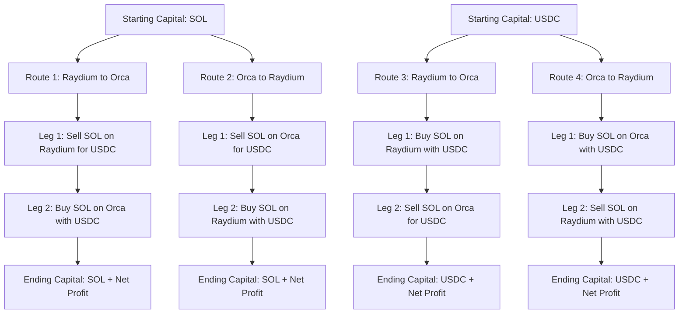
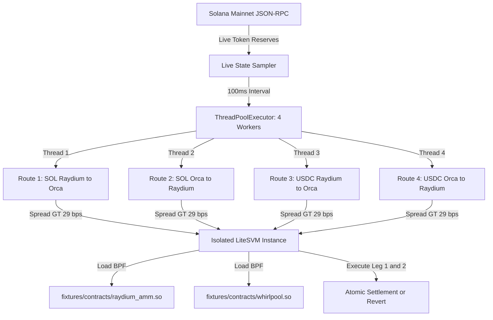

# Name

**Multi-Market Arbitrage & Simulation Engine (Raydium V4 & Orca Whirlpools)**

---

## Description

This branch implements an autonomous on-chain multi-market arbitrage and latency testing harness between **Raydium AMM V4** and **Orca Whirlpools** executed locally inside **LiteSVM** using live on-chain Mainnet state.

The suite contains two specialized execution engines:
1. **`circular_arbitrage.py`** — Multithreaded two-way closed-loop spatial arbitrage engine (`SOL -> SOL` and `USDC -> USDC`) evaluating 4 circular routes simultaneously across parallel CPU worker threads every 100 ms.
2. **`live_arbitrage_monitor.py`** — High-frequency dual-market price monitor and network latency simulation (400 ms) with on-chain slippage reversion inside LiteSVM.

---

### In-Depth Technical & Logical Architecture

#### Engine 1: `circular_arbitrage.py` (Two-Way Circular Spatial Arbitrage Engine)
1. **Closed-Loop Invariant:** Eliminates directional inventory risk by evaluating closed cycles where the trader starts and ends with the exact same asset:
   - **Route 1 (`SOL -> SOL`):** Sell SOL on Raydium for USDC -> Buy back SOL on Orca -> Accumulate net SOL.
   - **Route 2 (`SOL -> SOL`):** Sell SOL on Orca for USDC -> Buy back SOL on Raydium -> Accumulate net SOL.
   - **Route 3 (`USDC -> USDC`):** Buy SOL on Raydium with USDC -> Sell back SOL on Orca -> Accumulate net USDC.
   - **Route 4 (`USDC -> USDC`):** Buy SOL on Orca with USDC -> Sell back SOL on Raydium -> Accumulate net USDC.
2. **Multithreaded Parallel Concurrency:** Dispatches all four circular routes into a `concurrent.futures.ThreadPoolExecutor(max_workers=4)`. All four loops are evaluated concurrently in memory on separate CPU cores every 100 milliseconds.
3. **Exact Fee & Concentrated Liquidity Math:** Calculates Raydium constant-product pool deductions (25 bps) and Orca tick-spacing liquidity step-math (4 bps) for a total round-trip fee friction of ~29 bps. Only opportunities exceeding this combined threshold are flagged as profitable.
4. **Anchor IDL & Dual-DEX LiteSVM Execution:** Constructs instruction payloads using Anchor's instruction selector (`0xf8c69e91e17587c8`) and exact 12-account resolution vectors, executing against both `raydium_amm.so` and `whirlpool.so` on LiteSVM.

#### Engine 2: `live_arbitrage_monitor.py` (Real-Time Disparity & Latency Simulation)
1. **Live State Extraction:** Connects to Solana Mainnet JSON-RPC every 500 ms to sample live 64-bit token reserves from Raydium's `coin_vault` and `pc_vault` (offsets `64..72`), alongside the Q64.64 fixed-point square-root price from Orca's Whirlpool account (offsets `65..81`).
2. **Divergence Detection:** Calculates spot prices across both AMMs simultaneously. When the absolute price spread exceeds a defined threshold (0.03%), an arbitrage execution candidate is registered at Slot T0.
3. **Network Latency Simulation:** Enforces a deterministic propagation delay (400 ms) representing in-flight network transit, validator mempool queuing, and slot leadership handoff.
4. **On-Chain Execution & Slippage Reversion:** Re-queries the live state at Slot T1, hydrates an isolated LiteSVM instance, and executes the trade against real BPF bytecode. If other traders on Mainnet shifted the pool balance during the 400 ms window such that minimum output was breached, the compiled contract triggers an on-chain program error (`Custom(30): Exceeded desired slippage limit`) and reverts the transaction with zero capital loss.

---

### Fixtures

```text
fixtures/
├── contracts/                  # Compiled on-chain Berkeley Packet Filter (.so) binaries
│   ├── raydium_amm.so          # Raydium AMM V4 bytecode
│   ├── raydium_cp_swap.so      # Raydium Constant-Product Swap reference bytecode
│   ├── serum_dex.so            # Serum / OpenBook orderbook engine bytecode
│   ├── spl_token.so            # Canonical Solana SPL Token program bytecode
│   └── whirlpool.so            # Orca Whirlpool concentrated liquidity bytecode
└── accounts/                   # Mainnet ledger account snapshots (.json)
    ├── manifest.json           # Contextual descriptions and metadata for each account
    ├── raydium_pool.json       # Raydium AMM pool state
    ├── coin_vault.json         # WSOL base reserve vault
    ├── pc_vault.json           # USDC quote reserve vault
    ├── open_orders.json        # Serum orderbook open orders
    ├── target_orders.json      # Raydium rebalancing orders
    ├── market.json             # Serum SOL/USDC market header
    ├── bids.json               # Serum buy orderbook slab
    ├── asks.json               # Serum sell orderbook slab
    ├── event_q.json            # Serum trade event queue
    ├── market_coin_vault.json  # Serum internal WSOL vault
    └── market_pc_vault.json    # Serum internal USDC vault
```

---

### Fixture Files Reference

#### Program Shared Object Binaries (`fixtures/contracts/*.so`)
- **`fixtures/contracts/raydium_amm.so`**  
  The official compiled Berkeley Packet Filter (BPF) binary of the Raydium AMM V4 smart contract. It executes native on-chain constant-product swap math, enforces 25 bps pool fee deductions, and validates pool state flags during local LiteSVM simulation.
- **`fixtures/contracts/whirlpool.so`**  
  The official compiled BPF binary of Orca Whirlpools dumped directly from Mainnet ProgramData account `CtXfPzz36dH5Ws4UYKZvrQ1Xqzn42ecDW6y8NKuiN8nD`. It implements concentrated liquidity tick calculations, sqrt-price curves, and Anchor instruction routing inside the VM.
- **`fixtures/contracts/spl_token.so`**  
  The canonical Solana Program Library (SPL) Token contract responsible for low-level token accounting. It executes balance debits, credits, transfers, and Associated Token Account (ATA) initializations across simulated trades.
- **`fixtures/contracts/serum_dex.so`**  
  The compiled Serum DEX / OpenBook orderbook contract. Raydium AMM V4 is architected as a hybrid protocol that routes through Serum orderbooks, making this binary required by Raydium to validate market state and execute swaps.
- **`fixtures/contracts/raydium_cp_swap.so`**  
  The compiled BPF binary for Raydium Constant Product Swap (CP-Swap) program. It provides the reference execution runtime for standard pool mathematical validation and cross-testing against AMM V4.

#### Ledger Account Snapshots (`fixtures/accounts/*.json`)
- **`fixtures/accounts/manifest.json`**  
  JSON metadata file providing human-readable descriptions, account types, and base58 public keys for all account snapshots in the project.
- **`fixtures/accounts/raydium_pool.json`**  
  Contains the core on-chain state of the Raydium SOL/USDC market pool (`58oQChx4yWmvKdwLLZzBi4ChoCc2fqCUWBkwMihLYQo2`). It defines pool status flags, fee rates, token mint references, and authority PDA addresses needed for swap validation.
- **`fixtures/accounts/coin_vault.json`**  
  The SPL Token account holding Raydium's native WSOL vault reserves (`DQyrAcCrDXQ7NeoqGgDCZwBvWDcYmFCjSb9JtteuvPpz`). LiteSVM reads the raw byte layout at offsets 64..72 to verify live SOL balances during swap execution.
- **`fixtures/accounts/pc_vault.json`**  
  The SPL Token account holding Raydium's USDC vault reserves (`HLmqeL62xR1QoZ1HKKbXRrdN1p3phKpxRMb2VVopvBBz`). It holds the quote-token reserves used by the constant-product formula to compute price quotes and transfer USDC outputs.
- **`fixtures/accounts/open_orders.json`**  
  The on-chain account tracking open orders placed by Raydium on the Serum DEX orderbook (`HRk9CMrpq7Jn9sh7mzxE8CChHG8dneX9TXE7j13bPR72`). Raydium's smart contract requires this account to calculate total pool liquidity.
- **`fixtures/accounts/target_orders.json`**  
  The target orders rebalancing account (`CZza3Ej4Mc58MnxWA385itKujMYYiRwBfZLq7wn99u9g`) used by Raydium to manage depth on the orderbook. It is verified by the AMM program as part of its required 18-account swap metadata array.
- **`fixtures/accounts/market.json`**  
  The Serum SOL/USDC market configuration account (`9wFFyRfZBsuAha4YcuxcXLKwMxJR43S7fPfQLusDBzvT`). It defines base and quote lot sizes, orderbook pointers, and vault signer seeds for the hybrid market.
- **`fixtures/accounts/bids.json`**  
  The memory slab tree containing active buy orders on the Serum orderbook. The Raydium program inspects this account during instruction processing to ensure the hybrid market state is intact.
- **`fixtures/accounts/asks.json`**  
  The memory slab tree containing active sell orders on the Serum orderbook. It represents the ask-side orderbook depth required alongside `bids.json` for Serum market validity checks.
- **`fixtures/accounts/event_q.json`**  
  The trade execution and event settlement queue account for Serum. It logs filled orders and trade events that Raydium validates before finalizing token movements.
- **`fixtures/accounts/market_coin_vault.json`**  
  The internal Serum WSOL vault account referenced by the market header. Raydium checks this vault to ensure funds are properly segregated between AMM vaults and orderbook vaults.
- **`fixtures/accounts/market_pc_vault.json`**  
  The internal Serum USDC vault account referenced by the market header. It holds quote-side tokens committed to the Serum orderbook, completing the required market account array.

---

## Badges

[](https://solana.com)
[](https://github.com/jito-foundation/litesvm)
[](https://python.org)
[](https://gitlab.com/mister_octopus/scorpion_iinternship_project/-/tree/feat/circular-arbitrage)

---

## Visuals

### Two-Way Circular Arbitrage Cycle Routing



### Multithreaded Concurrency & LiteSVM Execution Flow



---

## Installation

### 1. Activate Environment
Activates the project's Python virtual environment:
```bash
source ~/solana_env/bin/activate
```

### 2. Verify Python Runtime & LiteSVM Dependency
Verifies that `solders` (v0.21.0) is present for LiteSVM execution:
```bash
pip show solders
```

---

## Usage

Each script runs out-of-the-box with **zero required arguments**:

### 1. Execute Multithreaded Circular Arbitrage Engine

Activate the environment:
```bash
source ~/solana_env/bin/activate
```

Navigate to repository root:
```bash
cd scorpion_iinternship_project
```

Run with zero arguments (runs 10 sample iterations and exits cleanly):
```bash
python early-code/circular_arbitrage.py
```

Run in continuous real-time monitoring mode (100 ms interval):
```bash
python early-code/circular_arbitrage.py --continuous
```

**Expected Terminal Output:**
```text
================================================================================
 Two-Way Circular Arbitrage Monitor (SOL<->SOL & USDC<->USDC)
 Polling Interval:  100 ms
 Trade Quantities:  1.00 SOL | 120.00 USDC
 Minimum Profit:    >0.0000 token gain to trigger
 Signer Keypair:    GzdXR3tkDMgjVvzVCXj1YvCqW6VnSGSrk4wJ3Sn6LqNt
================================================================================
Time      Slot        Raydium ($)   Orca ($)      Best Path              Net Profit
--------------------------------------------------------------------------------
19:58:34  454323211   115.8679      115.8162      SOL via RAYDIUM_THEN_ORCA -0.0025 SOL (-0.246%)
19:58:35  454323218   115.8667      115.8162      SOL via RAYDIUM_THEN_ORCA -0.0025 SOL (-0.247%)
19:58:36  454323221   115.8667      115.8162      SOL via RAYDIUM_THEN_ORCA -0.0025 SOL (-0.247%)
```

---

### 2. Execute Real-Time Live Arbitrage & Latency Monitor

Activate the environment:
```bash
source ~/solana_env/bin/activate
```

Navigate to repository root:
```bash
cd scorpion_iinternship_project
```

Run with zero arguments (runs 10 sample iterations and exits cleanly):
```bash
python early-code/live_arbitrage_monitor.py
```

Run in continuous mode:
```bash
python early-code/live_arbitrage_monitor.py --continuous
```

**Expected Terminal Output:**
```text
============================================================================
 Solana Mainnet Multi-Market Arbitrage & LiteSVM Execution Monitor
 Polling Interval:  500 ms
 Trigger Threshold: 0.030% spread
 Trade Amount:      1.00 SOL
 Signer Keypair:    GzdXR3tkDMgjVvzVCXj1YvCqW6VnSGSrk4wJ3Sn6LqNt
============================================================================
Time         Slot        Raydium ($)    Orca ($)       Spread ($)   Status
----------------------------------------------------------------------------
19:58:38     454323229   115.8667       115.8162       0.0504       ⚡ DIVERGENCE (0.04%)

────────────────────────────────────────────────────────────────────────────
[*] Price spread exceeded threshold! Testing trade in LiteSVM for 1.00 SOL...
  [+] Execution Status: Swap successfully confirmed on LiteSVM against live market state.
  [+] Received Output:  115.5238 USDC
  [+] Compute Units:    18,553 CUs
────────────────────────────────────────────────────────────────────────────
```

---

## Support

For technical inquiries regarding pool state layouts, BPF bytecode loaders, or LiteSVM execution boundaries, open an issue on the project repository or reach out directly via GitLab.

---

## Roadmap

- [x] **Two-Way Circular Spatial Arbitrage Engine:** Closed-loop `SOL -> SOL` and `USDC -> USDC` routes eliminating directional exposure.
- [x] **Multithreaded Parallel Route Evaluation:** 4 concurrent CPU workers evaluating routes at 100 ms frequency.
- [x] **Live Dual-Market Monitoring & Latency Simulation:** Dynamic price sampling against Raydium and Orca with 400 ms latency simulation.
- [x] **On-Chain Slippage Enforcement in LiteSVM:** Bytecode execution against `raydium_amm.so` and `whirlpool.so` with smart contract revert handling.
- [x] **Structured Fixture Organization:** Categorized `fixtures/contracts/` and `fixtures/accounts/` directories with metadata manifest.

---

## Contributing

This branch follows standard GitLab feature sprint conventions:
1. All changes must be tested in an isolated virtual environment (`solana_env`).
2. New simulations must run out-of-the-box with zero required CLI arguments.
3. Code must execute cleanly with exit code 0 before submitting Merge Requests.

---

## Authors and acknowledgment

- **Developer:** Scorpion_Sign (GitLab: [`@sufierizwan4`](https://gitlab.com/sufierizwan4))
- **Project Tutor / Reviewer:** Andrew-Octopus (GitLab: [`@mister_octopus`](https://gitlab.com/mister_octopus))

---

## License

Internal educational project for internship evaluation.

---

## Project status

Active development on branch `feat/circular-arbitrage`. Two-way circular arbitrage and live latency simulation engines are implemented, verified in LiteSVM with exit code 0, and ready for review.