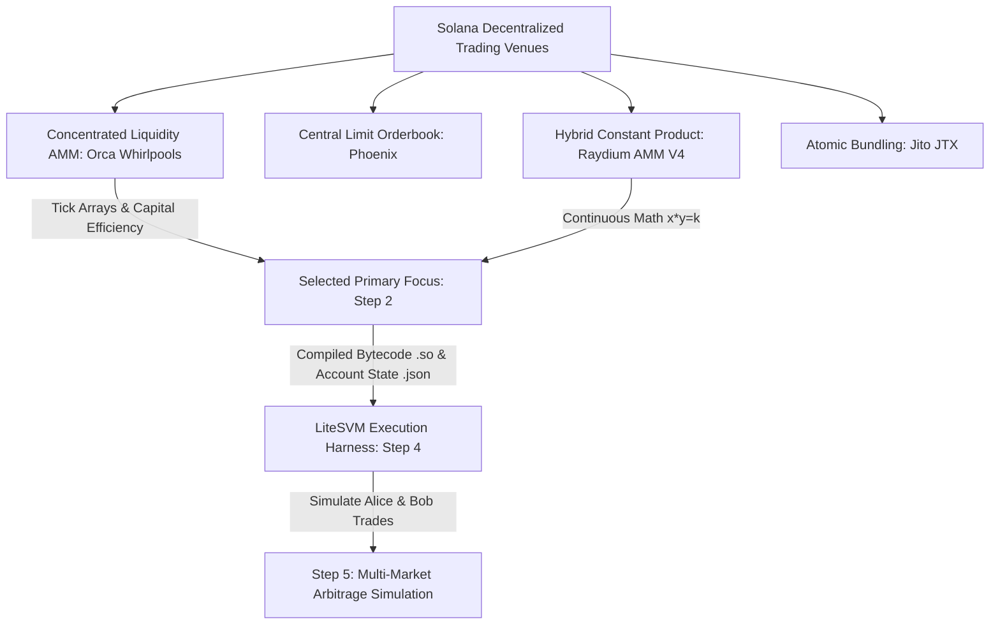

# Name

**Solana Market Research & Selection**

---

## Description

This module documents the technical evaluation and architectural selection of decentralized trading venues on the Solana blockchain for local Solana Virtual Machine (LiteSVM) simulation, arbitrage loop modeling, and oracle vulnerability testing.

### Background & Context
Designing automated market makers (AMMs), arbitrage algorithms, and on-chain liquidators on Solana requires deep architectural insight into how liquidity venues execute smart contract instructions, manage state serialization, handle compute unit (CU) limits, and enforce transaction atomicity:
- **Execution Overhead:** Different DEX architectures impose distinct compute unit profiles and account locking constraints.
- **Settlement Latency:** Traditional decentralized orderbooks rely on asynchronous two-phase cranking, whereas modern Solana venues utilize instant atomic settlement or tick-based execution.
- **Simulation Fidelity:** For local testing in **LiteSVM**, candidate venues must provide deterministic BPF smart contract bytecode (`.so`) that can be executed offline without live RPC validators or off-chain keeper networks.

---

### Researched Solana Trading Venues

#### 1. JTX (Jito Tip Exchange / MEV Bundles)
- **Program ID:** `T1pyyaTNZsKv2WcRAB8oVnk93mLJw2XzjtVYqCsaHqt`
- **Architecture:** Searcher bundle relayer and tip payment account infrastructure.
- **Mechanism:** Enables atomic transaction multi-packs that execute sequentially without intermediate state insertion or public mempool front-running risk.
- **Relevance:** Essential for constructing sandwich-resistant arbitrage loops, tip distribution calculations, and priority fee optimization.

#### 2. Orca Whirlpools (Concentrated Liquidity AMM - CLMM)
- **Program ID:** `whirLbMiicVdio4qvUfM5KAg6Ct8VwpYzGff3uctyCc`
- **Architecture:** Concentrated liquidity market maker dividing pool capital into discrete tick arrays (inspired by Uniswap v3).
- **Mechanism:** Liquidity providers allocate capital within explicit price intervals ($p_{min}, p_{max}$). Trades execute through localized tick arrays via deterministic single-instruction swaps (`swap` / `swap_v2`).
- **Relevance:** Enables precise simulation of price slippage across liquidity depths, tick crossing dynamics, fee tier structures (1 bps to 100 bps), and multi-hop pool rebalancing.

#### 3. Phoenix (Ellipsis Labs - Central Limit Orderbook)
- **Program ID:** `PhoeNiXZ8ByJGLkxNfZRnkUfjvmuYqLR89jjFHGqdXY`
- **Architecture:** Fully on-chain, non-cranked Central Limit Order Book (CLOB).
- **Mechanism:** Unlike legacy DEXs (e.g., Serum v3), Phoenix settles matching orders directly within the taker's transaction, eliminating asynchronous request queues and keeper cranking.
- **Relevance:** Critical for evaluating microsecond-level atomic arbitrage against deterministic limit order depths.

#### 4. Raydium AMM V4 (Constant Product AMM & Hybrid Orderbook)
- **Program ID:** `675kPX9MHTjS2zt1qfr1NYHuzeLXfQM9H24wFSUt1Mp8`
- **Architecture:** High-volume hybrid liquidity protocol combining constant product invariant pools ($x \cdot y = k$) with Serum/OpenBook order routing.
- **Mechanism:** Manages automated market making with 25 bps liquidity fees and routes residual order depths through external market accounts.
- **Relevance:** Deep liquidity and predictable pool math make it a baseline benchmark for cross-market price disparities and atomic arbitrage swaps.

---

### Comparative Evaluation Matrix

| Trading Venue | Model Architecture | SBF / Bytecode Availability | Settlement Latency | LiteSVM Simulation Viability | Primary Arbitrage Role |
| :--- | :--- | :--- | :--- | :--- | :--- |
| **Orca Whirlpools** | Concentrated Liquidity (CLMM) | Public Open Source (`orca-so/whirlpools`) | Single-Tx Atomic | **Optimal** (Deterministic tick math) | Price impact & slippage exploration |
| **Phoenix** | Central Limit Orderbook (CLOB) | Public BPF (`Ellipsis-Labs/phoenix-v1`) | Single-Tx Instant (No Cranks) | **High** (Compact memory footprint) | Maker/taker spread arbitrage |
| **Raydium AMM V4** | Constant Product ($x \cdot y = k$) | Verified Mainnet Bytecode (`.so`) | Single-Tx Swap | **Proven** (18-account swap instruction) | Core liquidity baseline |
| **Jito / JTX** | Atomic Bundle / Tip Engine | Public Interface & Client | Block Engine Sequencing | **High** (Composable with DEXs) | Frontrun/backrun bundle protection |

---

### Market Selection Decision & Technical Rationale

### Primary Selected Market: **Orca Whirlpools (CLMM)**
*Configured in `early-code/markets.py` as the primary venue for concentrated liquidity modeling, paired with Raydium AMM V4 for multi-venue price disparity arbitrage.*

#### Technical Rationale:
1. **Capital-Efficient Slippage Modeling:** Concentrated liquidity pools permit exact calculation of price movement across discrete tick boundaries, allowing AI arbitrage agents to discover non-trivial routing opportunities.
2. **Deterministic Single-Instruction Swaps:** Unlike multi-phase orderbooks that require asynchronous settlement, Whirlpool swaps execute synchronously in a single instruction with zero off-chain keeper dependencies.
3. **Reproducible Test Fixtures:** Whirlpool bytecode and account structures can be loaded into LiteSVM memory without mock RPC servers or network connection latency.
4. **Seamless Simulation Pipeline:** Provides clean programmatic interfaces for creating token mints, seeding pool reserves, initializing trader wallets (Alice & Bob), and tracking post-trade balances.

---

## Badges

[](https://solana.com)
[](https://gitlab.com/mister_octopus/scorpion_iinternship_project)
[](https://python.org)
[](https://gitlab.com/mister_octopus/scorpion_iinternship_project/-/tree/feat/market-selection)

---

## Visuals

### Solana Market Taxonomy & Simulation Architecture



---

## Usage

### 1. Inspect Researched Market Configurations
Executes the market selection definition module to inspect and verify active venue parameters:
```bash
python early-code/markets.py
```

**Expected Terminal Output:**
```text
==================================================
 Solana Market Selection (Step 1 & Step 2)
==================================================
Selected Market : Orca Whirlpools
Program ID      : whirLbMiicVdio4qvUfM5KAg6Ct8VwpYzGff3uctyCc
Market Type     : Concentrated Liquidity AMM (CLMM)
Description     : Tick-based concentrated liquidity pool with deterministic single-instruction swaps.
==================================================
Ready for Step 4 (LiteSVM Alice & Bob trading script).
```

---

## Authors and acknowledgment

- **Developer:** Scorpion_Sign
- **Project Tutor / Reviewer:** Andrew-Octopus